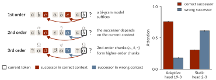

# A circuit for predicting hierarchical structure in-context in Large Language Models

Tankred Saanum\*, Can Demircan\*, Samuel J. Gershman, Eric Schulz. [arXiv:2509.21534](https://arxiv.org/abs/2509.21534)

Accepted at [BlackboxNLP 2026](https://blackboxnlp.github.io/) (oral).

LLMs predict repeating token sequences with hierarchical structure in-context. We find induction heads that learn in-context which past successors to attend to, and context matching heads that recover the latent context those induction heads need. This repository contains the code for all experiments and figures in the paper.

<p align="center">
  
</p>

## Install

```bash
uv sync
```

Python 3.12.5. Dependencies are pinned in `uv.lock`. Gemma 2 and Llama 3.2 are gated on Hugging Face and need `hf auth login`.

## Reproduce

```bash
bash bin/experiments.sh   # all experiments, needs a GPU
bash bin/plot.sh          # all figures and statistics
```

Each script in `bin/` is self-contained and takes `--help`. For example, the 2nd-order learning experiment on one model:

```bash
uv run bin/score_induction.py --model Qwen/Qwen2.5-1.5B
uv run bin/evaluate.py --model Qwen/Qwen2.5-1.5B --order 2
```

Results go to `data/` and figures to `figures/`, as SVG and PDF. The repository contains no results or model checkpoints, only the prompts in `data/language.json`. The figures use the [Lato](https://www.latofonts.com) font, which must be installed for matplotlib.

## Layout

```text
smart_induction_heads/   sequences, attention measures, head selection and ablation, small transformer
bin/                     one script per experiment or figure
data/language.json       ambiguous natural-language prompts (App. A.9)
```

## Citation

```bibtex
@misc{saanum2025circuit,
  title         = {A circuit for predicting hierarchical structure in-context in Large Language Models},
  author        = {Tankred Saanum and Can Demircan and Samuel J. Gershman and Eric Schulz},
  year          = {2025},
  eprint        = {2509.21534},
  archivePrefix = {arXiv},
  primaryClass  = {cs.LG},
  url           = {https://arxiv.org/abs/2509.21534}
}
```
